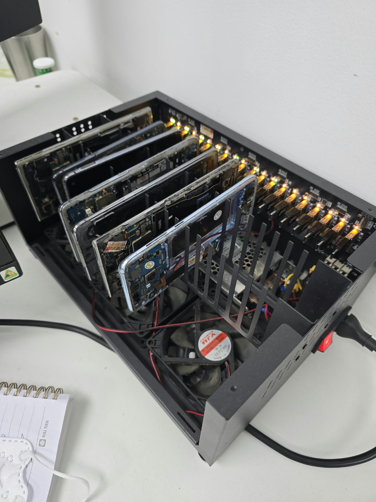
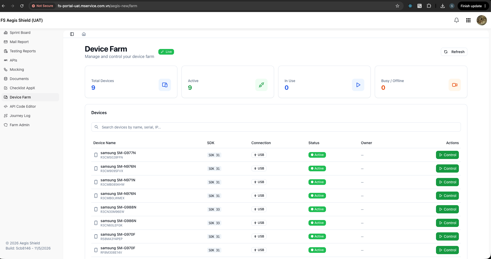
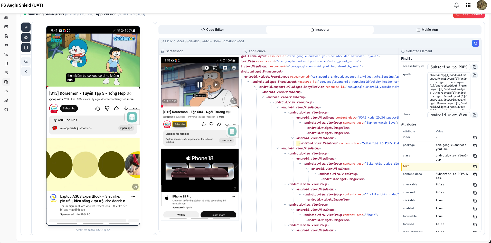

# farm-stream

Mục tiêu: stream màn hình device trong farm (mạng nội bộ) lên relay-server trên k8s để
frontend xem được từ VPN/nhà.

```
[Browser/VPN] ──wss──> [farm-stream server @ k8s] <──wss (dial-out)── [farm-stream agent @ máy farm]
                                                                          │  cùng 1 JVM:
                                                                          ├─ device server https://0.0.0.0:11000 (ws-scrcpy API)
                                                                          └─ tunnel agent (mở TCP/TLS tới host trong `ALLOW` theo yêu cầu)
                                                                          │
                                                               adb server :5037 ──> scrcpy-server 1.19-ws6 trên device (tcp:8886)
```


Wire protocol của tunnel (`[type:1][streamId:4][payload]`) và toàn bộ URL/endpoint giữ **nguyên** → relay Java và agent Node
(hoặc ngược lại) nói chuyện được với nhau, frontend không phải đổi gì (frontend vẫn gọi `/d/farm1/<ip>:11000/...`).

## Hình ảnh

**Farm.** Các device Android cắm trong hộp USB hub; agent chạy trên máy nối với hộp này.



**Danh sách device.** Feed `devices-list` hiển thị trên frontend FS Aegis Shield, đi qua relay từ ngoài mạng farm.



**Stream device.** Stream scrcpy trực tiếp qua `proxy-adb`, bên cạnh inspector (screenshot, app source, element đang chọn).



## Build

Cần JDK 21 + Maven (hydrangea lấy từ Maven Central).

```bash
cd farm-stream
mvn package            # chạy unit test + tạo target/farm-stream.jar (fat jar ~1 MB)
mvn package -DskipTests
```

Máy farm chỉ cần JRE 21 (`brew install openjdk@21`) nếu copy sẵn `target/farm-stream.jar` sang.

## Chạy trên máy farm (agent)

```bash
# giống bashfile/stream-relay.sh cũ, thêm phần device server
RELAY_INSECURE=true java -jar target/farm-stream.jar agent \
  --RELAY_URL=wss://<relay-host>/tunnel --AGENT_ID=farm1 --ALLOW=<farm-cidr>
```

Hoặc monitor có auto-restart: `bashfile/farm-stream.sh` (đã thay `streaming-device` + `stream-relay` trong
`bashfile/farm-services.sh`, Jenkins job `farm-services` dùng tên service `farm-stream`). Script tự `adb start-server`
nếu `adb` có trong PATH — Java chỉ nói chuyện với **adb server** (tcp 5037) qua giao thức ADB, không spawn binary `adb`.

Thành công khi log có:

```
... DeviceServer - device server listening on https://0.0.0.0:11000/
... TunnelAgent - tunnel established (allow: <farm-cidr>,127.0.0.1/32, default port 11000)
```


## Chạy relay-server (k8s)

```bash
PORT=18000 TUNNEL_TOKEN=<secret> java -jar farm-stream.jar server
```

Docker: `docker/Dockerfile` (multi-stage maven → temurin 21 JRE, tự sinh cert self-signed lúc build), manifest mẫu
`docker/k8s.example.yaml` (NodePort 30443, `replicas` phải là 1 vì tunnel giữ in-memory).
`.gitlab-ci.yml` của stream-relay dùng template Node (`node-js-single-module-trunkbase`) — khi đưa farm-stream lên CI
cần đổi sang template Java/Docker tương ứng của devops.

## Cấu hình

Mọi tham số là env var hoặc flag `--KEY=value` (flag ưu tiên hơn env).

| Tham số | Chế độ | Default | Ý nghĩa |
| --- | --- | --- | --- |
| `PORT` | server | `18000` | Port listen của relay |
| `TUNNEL_TOKEN` | server + agent | _(trống)_ | Shared secret xác thực agent |
| `OPEN_TIMEOUT_MS` | server | `10000` | Chờ agent mở kết nối tới farm |
| `RELAY_URL` | agent | — | `wss://<relay>/tunnel`; bỏ trống = chỉ chạy device server |
| `AGENT_ID` | agent | hostname | Tên trong URL `/d/<agent-id>/...` (FE đang dùng `farm1`) |
| `ALLOW` | agent | `127.0.0.1/32` | CIDR target được phép; `*` tắt kiểm tra |
| `DEFAULT_PORT` | agent | `11000` | Port khi URL không ghi `:port` |
| `RELAY_INSECURE` | agent, wspipe | `false` | `true` = bỏ verify cert self-signed của relay |
| `NO_TUNNEL` / `NO_DEVICE_SERVER` | agent | `false` | Chỉ chạy một nửa |
| `LISTEN_PORT` | agent | `11000` | Port device server |
| `CERT_PATH` + `KEY_PATH` | cả hai | `ssl/server.crt\|key` hoặc `../ssl/` | Cert PEM (PKCS#8 hoặc PKCS#1). `ssl/` không nằm trong git, tự sinh bằng `openssl req -x509` (xem README.md) |
| `NO_TLS` | cả hai | `false` | Chạy HTTP thường (TLS ở ingress) |
| `ADB_HOST` / `ADB_PORT` | agent | `127.0.0.1` / `5037` | adb server |
| `ADB_AUTOSTART` | agent | `true` | Khi adb server chết (connection refused tới `ADB_PORT`) thì tự chạy `adb start-server` rồi connect lại ngay |
| `ADB_BIN` | agent | _(tự tìm)_ | Đường dẫn adb cho `ADB_AUTOSTART`; mặc định tìm trong PATH, rồi `$ANDROID_HOME`/`$ANDROID_SDK_ROOT`/platform-tools, rồi `~/Library/Android/sdk/platform-tools` (macOS) hoặc `~/Android/Sdk/platform-tools` (Linux) |
| `DB_HOST` `DB_PORT` `DB_NAME` `DB_USER` | agent | `127.0.0.1` / `5432` / `fs_core` / `fs_core` | PostgreSQL bảng `aegis_shield.devices` |
| `DB_PASSWORD` | agent | **không có default** | Bắt buộc nếu dùng DB; thiếu thì log error và chạy in-memory. Trên farm host đặt trong `bashfile/.env` (git-ignored, mẫu ở `bashfile/.env.example`), script `farm-stream.sh` tự source |
| `DB_DISABLED` | agent | `false` | `true` = không dùng DB (vẫn chạy in-memory; DB lỗi lúc start cũng tự fallback) |
| `LOG_LEVEL` | cả hai | `INFO` | `DEBUG` in thêm log hydrangea và metadata message của stream |

## Route của relay (giữ nguyên stream-relay)

- `/d/<agent>/<ip[:port]>/<path>` — agent dial target bằng **TLS** (streaming-device, Appium https, code-editor)
- `/p/<agent>/<ip[:port]>/<path>` — TCP thường
- `/dk/`, `/pk/` — keep-path (upstream nhận nguyên URL, cho Jenkins `--prefix`)
- `/t/<agent>/<ip:port>` — raw TCP qua WebSocket (ssh/adb), client dùng `wspipe`
- `GET /healthz`, `GET /agents`

Cách relay chuyển HTTP qua tunnel: request head được viết lại (Host, `Connection: close`) và replay lên stream;
response `101` (WebSocket) và `2xx` được **pipe thẳng** byte-by-byte (video, mjpeg, download lớn không buffer);
response khác được buffer (tự de-chunk) rồi trả lại như response thường. Backpressure: tunnel WS không writable
→ pause đọc socket phía client/target (thay cho poll `bufferedAmount` của Node).

```bash
# ssh qua relay
ssh -o ProxyCommand='java -jar <repo>/farm-stream/target/farm-stream.jar wspipe --insecure wss://<relay-host>/t/farm1/%h:%p' user@<farm-ip>
```

## API của device server (giữ nguyên streaming-device)

WebSocket trên `/?action=...` (origin nào cũng chấp nhận, message tối đa 50 MB):

| action | Mô tả |
| --- | --- |
| `devices-list` | Push JSON array thiết bị (`device, ipv4, uuid, connect_type, status_recodd, device_status, label, sdk_version, used_by, wifi_ssid`); client gửi bất kỳ message nào để refresh |
| `proxy-adb&udid=&remote=tcp:8886[&path=][&user=][&record=][&replay=]` | Stream scrcpy: `adb forward` rồi proxy WS hai chiều tới scrcpy-server; đánh dấu IN_USE/ACTIVE theo `user`. Cũng nhận dạng path `/proxy-adb/<udid>/<remote>/<path>` |
| `proxy-ws&ws=<url>[&session=]` | Proxy tới WS URL bất kỳ |
| `record-status` | Snapshot trạng thái record/run/pause/stop |
| `goog-device-list` | Protocol device tracker của ws-scrcpy (`devicelist`/`device`, nhận lệnh `kill_server`/`start_server`/`restart_server`/`update_interfaces`) |

HTTP JSON (CORS `*`): `POST /api/goog/device/{pid,config,restart,send-binary,install-apk,install-apk-binary,install-uploaded}`,
`POST /api/recordings/{start,stop,run,pause,resume,update-name,delete}`, `GET /api/recordings`,
`POST /api/devices/connect`, `POST /api/device/keep-awake`, `POST /api/device/stop-using`,
`GET /api/sync`, `POST /api/sync/{set,clear}`. Body/response giống hệt bản Node (xem `device/ApiRoutes.java`).

Khi device cắm vào: tracker (`host:track-devices`) tạo `AndroidDevice` → lấy getprop, interface, push
`scrcpy-server.jar` (bundled trong jar, 1.19-ws6) lên `/data/local/tmp/` và chạy `app_process` với `nohup`, chờ pid
file `/data/local/tmp/ws_scrcpy.pid` — y như streaming-device. Bitrate/VideoSettings vẫn 35 byte **big-endian**.

## Khác biệt so với bản Node

- **Bỏ**: iOS/WDA/QVH (build config cũ đã `INCLUDE_APPL: false`), `?action=multiplex` + các channel HSTS/FSLS/SHEL/devtools
  (chỉ UI gốc ws-scrcpy dùng, UI đó không được serve nữa), MJPEG proxy, static `public/` (rỗng), `android-device-list`
  (label = "Manufacturer Model").
- adb: dùng thẳng giao thức ADB server (track/shell/sync push/forward/connect/tcpip/usb) thay cho adbkit + spawn `adb`;
  cài apk = push + `pm install -r`, xapk/zip = `pm install-create/-write/-commit`.
- Proxy stream device→browser có backpressure (browser chậm/VPN thì tạm dừng đọc từ device thay vì buffer vô hạn).
- `recordings/` và `uploads/` nằm trong working directory (cwd) của process, như cũ.

## Cấu trúc

```
src/main/java/com/mservice/farmstream/
  Main.java, AgentMain.java              entry + chế độ agent
  relay/   Frame, Tunnel, ProxyRoute, RelayServer, ProxyStream, TunnelAgent, WsPipe
  adb/     AdbClient                     giao thức ADB server (blocking, virtual thread)
  device/  DeviceServer, ApiRoutes, DeviceRegistry, AndroidDevice, ScrcpyServer, StreamProxy,
           DeviceListService, DeviceStatusService, DeviceRepository (hydrangea-postgres),
           RecordingStore, RecordingStatusService, SyncService, KeepAwakeService, VideoSettings, ...
  util/    Config (env + --flag), Json, Pem (PEM → SSLContext, trust-all)
src/main/resources/scrcpy-server.jar     server chạy trên device (+ LICENSE)
```

## Test nhanh trên máy dev

```bash
mvn package
java -jar target/farm-stream.jar server --PORT=18001 --NO_TLS=true &
java -jar target/farm-stream.jar agent --NO_DEVICE_SERVER=true --RELAY_URL=ws://127.0.0.1:18001/tunnel --AGENT_ID=test --ALLOW='*' &
curl http://127.0.0.1:18001/agents
curl http://127.0.0.1:18001/p/test/127.0.0.1:<port của 1 http server bất kỳ>/
adb start-server && java -jar target/farm-stream.jar agent --NO_TUNNEL=true --LISTEN_PORT=11001 --DB_DISABLED=true &
curl -k https://127.0.0.1:11001/api/sync
```
